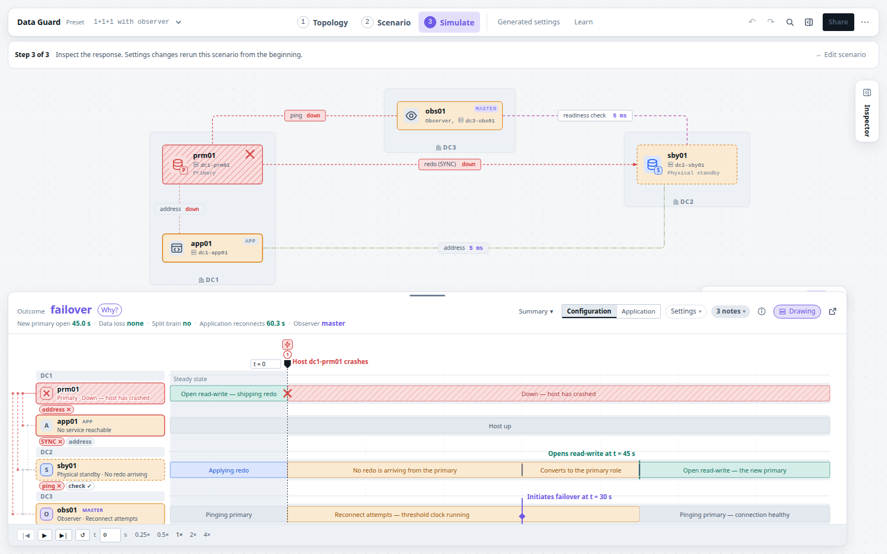

# Data Guard Workbench

Draw an Oracle Data Guard configuration, break it, and watch the clocks.

**Live:** https://dataguard.davidbudac.cz/ — a static page, no account, no
tracking, zero network requests once loaded.



The workbench is a simulator for Oracle Data Guard topologies: primaries,
physical standbys, far syncs, cascades, several standbys, several observers,
RAC members. You draw one, schedule failures and recoveries on a timeline, and
read off what the broker does, when, and why — fast-start failover timing,
commit cost under SYNC, FASTSYNC and ASYNC, the redo routes, reopen behaviour
after a lost link, and the DGMGRL, `LOG_ARCHIVE_DEST_n`, `tnsnames.ora` and
JDBC text that would set it all up, generated live.

## What it does

- **Topology.** Draw members and connections, set the broker and transport
  properties, and watch the validation findings and the steady-state readout
  follow every edit. Twelve presets cover the usual shapes.
- **Scenario.** Schedule failures and recoveries on an event-only timeline:
  a primary crash, an isolated primary, a severed link, a lost observer, a
  lost standby, a planned switchover.
- **Simulate.** The response of every member and observer, lane by lane, with
  the final outcome and the decisions behind it. Edit a setting beside the
  lanes and the same scenario recomputes immediately.
- **Config.** The generated configuration: DGMGRL, destinations, redo routes,
  connect strings, `SHOW CONFIGURATION` mock-ups.
- **Learn.** Ten lessons, each step driving the workbench beside the prose.
- **Import an existing setup.** A read-only SQL collector describes what you
  have; the workbench draws it.
- **Share and save.** A configuration is a link, an exported file, or a named
  copy in the browser. Reports print to PDF.

Everything the page asserts about Oracle is one of three things: arithmetic
over what you typed, a documented fact with a citation you can open, or a
quantity labelled on screen as this page's model. The type system enforces the
split (`app/design/engine.md`), the citation catalogue is tested against the
pages it cites, and the two reviews against Oracle's documentation are in
[`docs/fact-checks/`](docs/fact-checks/).

## Running it

Node 22 or newer.

```bash
cd app
npm install
npm run dev        # Vite dev server
npm test           # vitest
npm run build      # typecheck, then a static build into ../_site/
```

The whole site, from the repository root, is `node site/build.mjs`: the
application, then the frozen single-page explainer it replaced (served at
`/legacy/`), then two guards that fail the build on anything the content
security policy would reject.

### Local CI

There is no hosted CI. `site/check.sh` is the pipeline, and it runs on your
machine:

```bash
./site/check.sh            # typecheck, tests, legacy tests, build, browser smoke
./site/check.sh --quick    # stops after the tests
git config core.hooksPath .githooks   # run the quick form before every push
```

The smoke test needs headless Chrome (`CHROME=/path/to/chrome` if it is not at
`/usr/bin/google-chrome`); without it, that step is skipped and says so.

## Repository

| Path | What |
|---|---|
| `app/` | The workbench: TypeScript, Vite, Preact, `@preact/signals`. A pure, DOM-free engine in `src/engine`, the interface in `src/ui`, lessons in `src/content`, presets in `src/presets`. [`app/README.md`](app/README.md) is the developer guide |
| `app/design/` | The design documents: `facts.md` (the verified Oracle fact sheet), `engine.md`, `ui.md` |
| `simulator/` | The frozen single-page fast-start failover explainer, still served at `/legacy/` |
| `diagrams/` | The four figures both pages share, with the verified property tables behind them |
| `desktop/` | A Tauri v2 shell (macOS, Windows) around the same build. Installers come out of `.github/workflows/desktop.yml` on a `v*` tag and are **unsigned**: expect a Gatekeeper or SmartScreen warning |
| `site/` | Build, local CI, smoke test, publishing |
| `testing/` | A runbook of drills against a real 19c configuration |
| `docs/` | Agent procedures, the fact-check reports, retired documents |
| `AGENTS.md` | The long-form handoff: inventory, accuracy rules, conventions, publishing |

## Publishing

`./site/publish.sh` builds, runs every gate, ships `_site/` over ssh and
verifies the public URL byte for byte. The target host is not in the
repository: copy `site/publish.env.example` to `site/publish.env`.

## Contributing

See [CONTRIBUTING.md](CONTRIBUTING.md). The one rule that matters most: a
claim about Oracle is either cited from docs.oracle.com or labelled as this
page's model, never asserted bare. Problems and ideas go to
[GitHub Issues](https://github.com/davidbudac/dataguard-doc/issues); security
matters to [SECURITY.md](SECURITY.md).

## Disclaimer

This is an independent, unofficial tool. It is not affiliated with, endorsed
by or supported by Oracle. Oracle, Oracle Database and Data Guard are
trademarks of Oracle and/or its affiliates. The citation catalogue
(`app/src/engine/citations.ts`) quotes short passages of Oracle's product
documentation so that each documented fact can be checked against its source;
those passages remain Oracle's and are not covered by this repository's
license. The simulation is a model: use it to understand a configuration, not
as a recovery-time commitment.

## License

[MIT](LICENSE) © 2026 David Budac.
